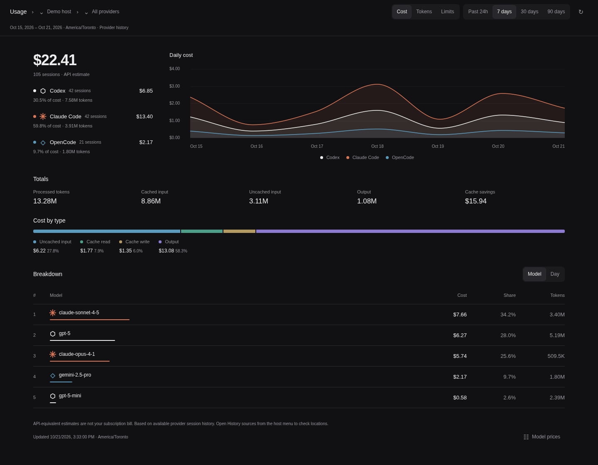

# Paseo Usage

Track token usage, API cost estimates and subscription limits in Paseo. View Codex, Claude Code, Grok Build, OpenCode, Antigravity, Pi and Cursor history, including sessions created outside Paseo.

Ported and adapted from [T3 Code](https://github.com/pingdotgg/t3code).



## Install

Requires **Paseo 0.12.0** and [VitePlus](https://viteplus.dev), with `vp` available in the Paseo daemon's PATH.

```sh
paseo plugin install https://github.com/pelletiermaxime/paseo-usage --id usage
```

Open **Usage** from the sidebar or choose **Open Usage** in the command menu.

## Using Usage

Choose **Cost**, **Tokens** or **Limits**. For usage history, select the past 24 hours or 7, 30 or 90 days. Filter by provider, follow activity on the chart, or click a model for its detailed breakdown.

Click the host name in the top bar to configure:

- **History sources**: add provider directories or Cursor CLI login files when your accounts use custom locations.
- **Model prices**: set USD prices per million tokens or map a model name to a known model.

Costs are API-equivalent estimates; your subscription bill may differ. Model prices come from LiteLLM and are cached for 12 hours. Unknown prices appear as **Unpriced**, and incomplete estimates are marked **partial**.

The Limits view shows available quotas and reset times for accounts connected to Paseo. Paseo may cache these readings for up to five minutes, so checking again can return the same values.

## Data and privacy

Local history is read from provider logs and databases on the selected Paseo host. Missing or deleted history cannot be recovered, and incomplete sources are flagged on the page.

Cursor history requires a saved Cursor CLI login and includes account usage from other machines. Its credentials are used only to authenticate requests to cursor.com and are never saved in plugin preferences. On macOS, Keychain access is off by default; enable it in **History sources** if needed.

Local conversation contents are not uploaded. Settings are saved separately for each Paseo host.

## License

[MIT](LICENSE). See [THIRD_PARTY_NOTICES.md](THIRD_PARTY_NOTICES.md) for upstream attribution and license notices.
